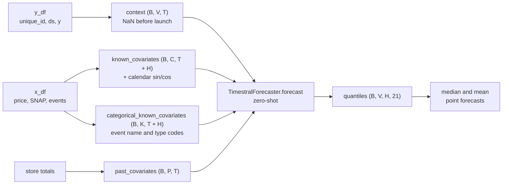
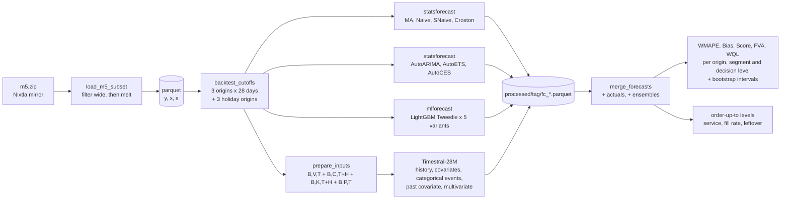

# Timestral Forecast

[](https://github.com/skateddu/timestral-forecast/actions/workflows/ci.yml)
[](https://www.python.org/)
[](LICENSE)
[](https://github.com/astral-sh/uv)
[](https://github.com/astral-sh/ruff)
[](https://huggingface.co/mistralai/Timestral-28M)
[](timestral_analysis.ipynb)

> Can a zero-shot foundation model forecast retail demand better than the methods planners use
> today? A benchmark of Mistral AI's **Timestral** against statistical, machine learning and
> ensemble baselines on Walmart's M5 data.

---

## Overview

[Timestral](https://github.com/mistralai/timestral) (Mistral AI, October 2026) is a family of
foundation models for time series that forecast series they have never seen, with no training. This
repository puts it on a real demand forecasting problem: department **FOODS_3** of the **M5** dataset
in three stores (CA_1, TX_1, WI_1), **2,469 daily series**, mostly intermittent, forecast 28 days ahead.

It is compared, on the same origins and with the same metrics, with:

- **baselines:** 28-day moving average, Naive, SeasonalNaive, Croston SBA;
- **time series models:** AutoARIMA, AutoETS, AutoCES;
- **machine learning:** global Tweedie LightGBM in three variants (plain, level-normalised,
  level-normalised with direct strategy), plus two **matched** variants that get exactly Timestral's
  inputs, for a comparison on the same information;
- **ensembles:** equal-weight averages of Timestral, LightGBM and a statistical model.

Timestral-28M runs in five configurations: on history only, with **known covariates** (price, SNAP
days, events, calendar), with events as **categorical covariates** (event name and type), with an extra
**past covariate** (store traffic), and **multivariate** (affine items of the same store forecast
jointly). The 209M checkpoint is left out: with covariates its forecasts
stayed unstable even with the safeguard described below.

The [notebook](timestral_analysis.ipynb) walks through the data, shows exactly
how the data is passed to Timestral, and discusses the results and the limits found along the way.

## Key Results

3 rolling origins × 28 days, 2,469 series, CPU. Ranking by the **mean score per origin**, where
score = WMAPE + |Bias| (lower is better); FVA is the score reduction versus the 28-day moving average.
Timestral's point forecast is the mean of its 21 quantiles unless noted.

| Model | WMAPE | Bias | Mean score per origin | FVA | Time (3 origins) |
|---|---|---|---|---|---|
| **Ensemble: Timestral-28M+cov, LightGBM-norm, AutoETS** | 62.4% | +0.7% | **64.6%** | **+5.8%** | sum of members |
| Ensemble: Timestral-28M+cov, LightGBM-norm, AutoARIMA | 62.8% | +0.6% | 64.9% | +5.4% | sum of members |
| **Timestral-28M + known covariates** | 63.5% | +1.2% | **65.2%** | **+4.9%** | 12 min |
| Timestral-28M + covariates + past covariate | 63.5% | +1.6% | 65.2% | +4.9% | 15 min |
| Timestral-28M multivariate | 63.5% | +1.8% | 65.4% | +4.7% | 5 min |
| Timestral-28M + covariates, categorical events | 63.9% | +1.7% | 65.7% | +4.2% | 15 min |
| LightGBM-norm | 63.7% | +2.0% | 66.3% | +3.3% | 1.3 min |
| Timestral-28M | 63.6% | +2.8% | 66.5% | +3.0% | 35 s |
| AutoETS | 63.5% | −1.2% | 67.5% | +1.6% | 1.3 min* |
| AutoARIMA | 64.6% | −1.3% | 67.6% | +1.4% | 33 min |
| Moving average 28 days | 64.9% | −3.7% | 68.6% | – | 16 s** |
| LightGBM-norm-matched (Timestral's inputs) | 64.8% | +6.0% | 70.9% | −3.5% | 42 s |
| AutoCES | **62.0%** | −9.5% | 71.6% | −4.4% | 1.3 min* |
| Timestral-28M (median) | 58.8% | −23.0% | 81.9% | −19.4% | 35 s |

\* AutoETS and AutoCES together. \*\* All baselines together. The full table, with every variant, is in
the notebook.

**Findings**

- **The point forecast matters more than the model.** With the median, Timestral has the best WMAPE of
  all but under-forecasts by 23%. With the mean of its quantiles the bias disappears and Timestral beats
  every benchmark, zero-shot. AutoCES falls into the same trap: lowest WMAPE, −9.5% bias.
- **The lead over the best benchmarks is likely, not certain.** A paired series-level bootstrap puts
  Timestral-28M+cov 1.0 point ahead of LightGBM-norm (95% interval −0.2 to +2.0) and 2.1 ahead of
  AutoETS (−0.2 to +3.8); it becomes clearer on weekly totals.
- **On the same information Timestral wins by five points.** LightGBM given exactly Timestral's inputs
  (no item / store ids, no day / month / year, raw price only, last 1,024 days) scores 70.9%, below the
  moving average: the tuned LightGBM owes its place to features Timestral does not use.
- **Known covariates help the 28M by 1.3 points, but only with a safeguard**: the price of series whose
  price never moved must be masked, otherwise the upper quantiles blow up
  ([mistralai/timestral#7](https://github.com/mistralai/timestral/issues/7)).
- **Categorical events, past covariate and multivariate add nothing on the main origins.** The
  multivariate run matches the covariate run at less than half the cost.
- **Ensembles give the best score, but the gain is small** (+0.6 points): the members' daily errors are
  88–93% correlated.
- **At the level of the decision Timestral's lead grows.** On 28-day totals per series the best
  Timestral scores 26.7% against 28.5% for LightGBM-norm and 30.0% for the moving average.
- **Quantiles for stock decisions.** Order-up-to levels taken from Timestral's daily quantiles, combined
  with a small correlation between days fitted leave-one-origin-out (ρ ≈ 0.05–0.15), hit the target
  service on held-out origins: 82–83% for an 80% target, 90–91% for 90%, 96% for 98%, both weekly and
  over 28 days. A point forecast with a normal safety stock falls short (84–89% for a 98% target over
  28 days). At the same leftover stock the service / stock trade-off is about the same.

**Holiday windows reverse the ranking.** On the three origins whose windows contain Independence Day,
Thanksgiving and Christmas, AutoETS (73.9%) and the moving average (74.5%) beat the ensemble (78.0%),
Timestral-28M+cov (81.2%) and LightGBM-norm (82.0%). The WMAPE is almost the same for every model
(71–73%): the difference is a 7–10% over-forecast by Timestral and LightGBM, which project the usual
weekend peaks into holiday weekends. Events as categorical covariates are the one extension that helps
here (78.4%, +2.8 points over the 0/1 row): Timestral encodes Christmas at a third of an ordinary day, yet
on Christmas Day, with stores closed (2 units sold), it still forecasts 3,962 units instead of 4,641.

## How Timestral Is Used



- **Univariate in batch** (V = 1): each series is a batch element. **Multivariate** (V = 4): four
  affine items of the same store share a batch element and are forecast jointly.
- **Before launch the context is NaN**, not zero: the item was not on the shelf.
- **Known covariates** cover context and horizon; **past covariates** the context only.
- **Categorical covariates** are integer codes; Timestral target-encodes them per series over the
  context (the item's mean sales on past days of each category, shrunk towards its overall mean).
- The **constant-price mask** blanks the price row of series whose price never moved in the context.

## Methodology



### Data

- **M5**, department FOODS_3, stores CA_1, TX_1 and WI_1: 2,469 daily series from 2011-01-29 to
  2016-05-22.
- **Pre-launch:** the days before the first sale are not demand. They are removed for the Nixtla
  models (`trim_leading_zeros`) and become NaN in Timestral's context.
- **Known covariates:** selling price (weekly), the state's SNAP day, event day (0/1), event name and
  type (categorical), and, for Timestral and the matched LightGBM, sine/cosine of day of week and day of
  year. The other LightGBM variants use day of week, day of month, month and year.
- **Past covariate** (Timestral `+past` and `-mv` only): the daily department total of the series'
  store, observed up to the origin.

### Protocol

- **3 consecutive origins**, each followed by 28 days to forecast, over the last 12 observed weeks.
- **3 holiday origins** (2015-06-21, 2015-11-22, 2015-12-20) whose windows contain Independence Day,
  Thanksgiving, Christmas and New Year, for the subset of models in `Settings.holiday_jobs`.
- **Same origins and data for every model.** Each model sees only `ds <= origin`.
- **Every series is evaluated.** When a model produces no forecast, the forecast is 0.
- **Negative forecasts are clipped at zero** before metrics, plots and ensembles, quantiles included.
  In practice this matters for AutoARIMA, which goes below zero on 1.9% of the points (minimum −3.5);
  Timestral already clips (`clip_nonnegative`).

### Metrics

| Metric | Formula | Note |
|---|---|---|
| WMAPE | Σ\|F − A\| / ΣA | equals MAE%; minimised by the median, so it rewards under-forecasting |
| Bias | Σ(F − A) / ΣA | positive = over-forecasting |
| Score | WMAPE + \|Bias\| | VN1 metric (Vandeput); main ranking criterion, averaged over origins |
| FVA | 1 − score / score(MA28) | Forecast Value Added versus the moving average |
| WQL | 2 · mean_q Σ pinball_q / Σ\|A\| | quality of the whole distribution (Timestral only) |
| Coverage | share of A inside [q10, q90] | nominally 80% |

**Decision level.** `aggregate_periods` sums actuals and forecasts of each series over 7-day buckets
or the whole 28-day window before scoring: replenishment orders cover a week or a lead time, not a day.

**Uncertainty.** `bootstrap_scores` resamples the series with replacement (all their days and origins)
and recomputes the mean score per origin; `bootstrap_difference` gives paired differences against a
reference model with a percentile interval. The origins are not resampled.

**Stock decisions** (`inventory.py`). Per series, origin and period, an order-up-to level S at target
cycle service levels of 80–98%:

- from Timestral's daily quantiles, summed (`comonotonic`, days perfectly correlated), convolved by
  sampling (`independent`), or sampled through a one-factor Gaussian copula with correlation ρ between
  any two days (`correlated`); `correlation_sweep` and `cross_validate_correlation` choose ρ for each
  origin on the other origins;
- from a point forecast plus a normal safety stock, z · σ · √days, with σ the standard deviation of daily
  demand over the 56 days before the origin.

`service_metrics` reports the cycle service achieved, the fill rate and the leftover stock per unit sold.

### Models

| Model | Details |
|---|---|
| MA28 | mean of the last 28 days |
| Naive / SeasonalNaive | last value / same weekday of the previous week |
| CrostonSBA | method for intermittent demand |
| AutoARIMA | `season_length=7`, fit on the last 730 days to bound runtime |
| AutoETS / AutoCES | `season_length=7`, same 730-day window; CES = complex exponential smoothing |
| LightGBM | global, Tweedie (p = 1.1), lags 1–7, 14, 21, 28, rolling means and std, exponentially weighted mean, price, relative price (versus the series' median before the origin), SNAP, event, item and store as categoricals, recursive strategy |
| LightGBM-norm | as LightGBM, with each series divided by its recent level (mean of the last 56 days + 0.1) and rows weighted by that level, as in VN1 |
| LightGBM-norm-direct | as LightGBM-norm, with the direct strategy (`max_horizon=28`, one model per step), trained on the last 730 days |
| LightGBM-norm-matched | as LightGBM-norm with Timestral-28M+cov's inputs only: raw price, SNAP, event flag, sine/cosine of day of week and day of year, no item / store ids, trained on the last 1,024 days |
| LightGBM-norm-matched+cat | as LightGBM-norm-matched with event name and type as categoricals instead of the event flag |
| Timestral-28M | zero-shot, batched univariate, `max_context=1024`; median and mean of the 21 quantiles as point forecasts |
| Timestral-28M+cov | plus known covariates, with the constant price masked (see below) |
| Timestral-28M+cov+cat | as +cov with the event flag replaced by event name and type as categorical covariates |
| Timestral-28M+cov+past | plus the store total as past covariate |
| Timestral-28M-mv | 4 affine items of the same store per batch element (average-linkage clustering on the correlation of the last 52 weekly sales); store-level covariates only (SNAP, event, calendar, store total) |
| Ensembles | equal-weight means of Timestral-28M+cov (mean), LightGBM-norm and AutoARIMA or AutoETS |

### Timestral and covariates: unstable upper quantiles

With price among the covariates, some low-volume series got absurd upper quantiles: q99 of thousands of
units for items selling about 2 a day. The median stays sensible, so the issue shows up in the quantile
average, the point forecast we use. There are two causes.

1. **Constant price in the context.** Timestral normalises every covariate by its variability over the
   context. A price that has not moved for years (about 38% of the series-origin pairs in FOODS_3) and
   changes for the first time in the horizon becomes a huge jump after normalisation. **Fix:** for
   those series the price is passed as missing (`mask_constant_covariate`, setting
   `TF_TIMESTRAL_MASK_CONSTANT_PRICE`).
2. **`symmetric_averaging`.** The mirrored pass negates the price too, and a negative price is outside
   the training distribution. With the constant price already masked, keeping the symmetric average
   does no harm: on a sample with the problematic series it gives fewer blow-ups (7 against 10), so it
   stays on (`TF_TIMESTRAL_SYMMETRIC_AVERAGING_WITH_COVARIATES`).

On the full benchmark the 28M with covariates and masked price has no more blow-ups (largest mean
forecast below 90 units). The 209M with covariates still had a few anomalous cases, so it is left out of
the benchmark. The behaviour reproduces on synthetic data and is reported in
[mistralai/timestral#7](https://github.com/mistralai/timestral/issues/7).

### Runtime notes

- All reported results were produced on CPU; the device is set with `TF_DEVICE`.
- statsforecast runs with 16 workers and `OPENBLAS_NUM_THREADS=1`: without it, every worker starts its
  own BLAS thread pool and memory runs out.

## Limitations

The notebook has a dedicated section; in short:

- **Point forecast choice.** The median is the natural output but under-forecasts intermittent demand;
  the mean has to be approximated from 21 quantiles, which truncates the tails.
- **Covariates are fragile.** Per-series normalisation turns a first price change into an extreme
  input; the 209M stayed unstable with covariates even with the mask and is left out.
  `symmetric_averaging` also feeds the model negated prices. Covariates multiply the CPU cost by
  about 20.
- **Events are read, but only partly followed.** With categorical events Timestral tells a closure from
  other events, yet on holiday windows it still over-forecasts by about 7% and loses to simple models.
- **Multivariate needs shared covariates**, so item prices cannot be used there.
- **Possible training-data overlap.** M5 is public and widely used; we could not verify whether it is
  part of Timestral's pre-training corpus, which would flatter the zero-shot results.
- **Small sample of origins**: 3 main and 3 holiday windows; the bootstrap covers the choice of items,
  not of origins, and differences of one point between models are within the origin-to-origin
  variation.
- **Daily quantiles only.** For a stock decision over a period the quantiles of the days must be
  combined with a dependence the model does not provide; a correlation fitted on three origins works
  here but has to be re-fitted on other data.

## Project Structure

```text
timestral-forecast/
├── src/timestral_forecast/
│   ├── config.py                 # Settings (pydantic-settings, TF_* variables)
│   ├── data.py                   # M5 download and subset in long format, parquet cache
│   ├── preprocessing.py          # Origins, leading zeros, Timestral arrays, constant-price mask
│   ├── multivariate.py           # Affine groups of series for multivariate Timestral
│   ├── metrics.py                # WMAPE, bias, score, WQL, coverage, FVA, decision level, bootstrap
│   ├── inventory.py              # Order-up-to levels from quantiles or point + safety stock, service
│   ├── ensemble.py               # Equal-weight ensembles
│   ├── segmentation.py           # ADI / CV² classes (smooth, erratic, intermittent, lumpy)
│   ├── backtest.py               # Jobs of every model, cache, merge with actuals
│   ├── plotting.py               # Charts (matplotlib / seaborn)
│   ├── exceptions.py             # AppError hierarchy
│   └── models/
│       ├── baselines.py          # statsforecast: MA, Naive, SeasonalNaive, Croston, ARIMA, ETS, CES
│       ├── lgbm.py               # mlforecast + Tweedie LightGBM variants
│       └── timestral_model.py    # Timestral variants: loading, inputs, batching, quantiles -> frame
├── timestral_analysis.ipynb      # Main output: data, Timestral inputs, results, limits
├── tests/unit/                   # pytest, Timestral replaced by a fake forecaster
├── .github/workflows/ci.yml      # Ruff + pytest (Python 3.10 to 3.13) with coverage gate
├── pyproject.toml
├── uv.lock
└── LICENSE
```

## Dependencies

| Package | Description | Link |
|---|---|---|
| [timestral](https://github.com/mistralai/timestral) | Mistral AI's foundation model, installed from GitHub at a pinned commit | [GitHub](https://github.com/mistralai/timestral) |
| [PyTorch](https://pytorch.org/) | Runtime of Timestral | [Docs](https://docs.pytorch.org/docs/stable/) |
| [statsforecast](https://nixtlaverse.nixtla.io/statsforecast/) | Baselines, ARIMA, ETS, CES | [Docs](https://nixtlaverse.nixtla.io/statsforecast/) |
| [mlforecast](https://nixtlaverse.nixtla.io/mlforecast/) + [LightGBM](https://lightgbm.readthedocs.io/) | Global gradient boosting with lag features | [Docs](https://nixtlaverse.nixtla.io/mlforecast/) |
| [pandas](https://pandas.pydata.org/), [NumPy](https://numpy.org/), [SciPy](https://scipy.org/) | Data handling, arrays, hierarchical clustering | [Docs](https://pandas.pydata.org/docs/) |
| [pydantic-settings](https://docs.pydantic.dev/latest/concepts/pydantic_settings/) | Typed configuration from environment variables | [Docs](https://docs.pydantic.dev/latest/concepts/pydantic_settings/) |
| [Matplotlib](https://matplotlib.org/), [seaborn](https://seaborn.pydata.org/) | Charts | [Docs](https://matplotlib.org/stable/) |

Development tools (`dev` group): pytest, pytest-cov and Ruff.

## Installation

Requires Python 3.10+ and [uv](https://docs.astral.sh/uv/).

```bash
git clone https://github.com/skateddu/timestral-forecast.git
cd timestral-forecast
uv sync
```

Timestral's weights are downloaded from Hugging Face on first use (111 MB for the 28M).

## Usage

Everything runs from the notebook: open `timestral_analysis.ipynb` in your IDE with the `.venv`
kernel, or start JupyterLab:

```bash
uv run --with jupyterlab jupyter lab
```

The first run downloads M5 and computes every model (about 2.5 hours on CPU, most of it AutoARIMA and
Timestral with covariates); forecasts are cached in `data/processed/<department>_<stores>_<tag>/`,
where the tag is a hash of horizon and origin dates, and later runs take seconds.
For the long first run the notebook can also be executed headless:

```bash
uv run --with nbconvert jupyter nbconvert --to notebook --execute --inplace \
    --ExecutePreprocessor.timeout=-1 timestral_analysis.ipynb
```

Deleting a `fc_<job>.parquet` file in that folder (or `holidays_fc_<job>.parquet` in the holiday
origins' folder) recomputes only that model on the next run.

## Configuration

Every field of `Settings` can be overridden with a `TF_*` environment variable or a `.env` file (see
`.env.example`):

| Variable | Default | Meaning |
|---|---|---|
| `TF_DEVICE` | `cpu` | `cpu`, `cuda` or `auto` |
| `TF_STORE_IDS` | `["CA_1", "TX_1", "WI_1"]` | M5 stores |
| `TF_DEPT_ID` | `FOODS_3` | M5 department |
| `TF_N_WINDOWS` | `3` | number of 28-day backtest origins |
| `TF_HOLIDAY_CUTOFFS` | `["2015-06-21", "2015-11-22", "2015-12-20"]` | holiday origins |
| `TF_TIMESTRAL_MAX_CONTEXT` | `1024` | days of history passed to Timestral |
| `TF_TIMESTRAL_BATCH_SIZE` | `64` | batch elements per forward pass; lower it if memory runs out |
| `TF_TIMESTRAL_COVARIATE_MODELS` | `["mistralai/Timestral-28M"]` | checkpoints also run with covariates |
| `TF_TIMESTRAL_MASK_CONSTANT_PRICE` | `true` | ignore the price of series where it never moved in the context |
| `TF_TIMESTRAL_SYMMETRIC_AVERAGING_WITH_COVARIATES` | `true` | keep Timestral's mirrored pass in the covariate runs |
| `TF_TIMESTRAL_GROUP_SIZE` | `4` | variates per group in the multivariate run |
| `TF_N_JOBS` | `16` | statsforecast and LightGBM workers |

A change of stores, department, horizon or origins writes to a new cache folder. If you change a
model's settings, delete its `fc_<job>.parquet` files.

## Testing

```bash
uv run pytest                                        # unit tests, no model download
uv run pytest --cov=timestral_forecast               # with coverage (CI requires 80%)
uv run ruff check . && uv run ruff format --check .
```

## References

- Mistral AI: [Timestral inference code](https://github.com/mistralai/timestral) and
  [model weights](https://huggingface.co/mistralai/Timestral-28M)
- Makridakis, Spiliotis, Assimakopoulos: [The M5 competition](https://doi.org/10.1016/j.ijforecast.2021.11.013)
- Nixtla: [statsforecast](https://github.com/Nixtla/statsforecast), [mlforecast](https://github.com/Nixtla/mlforecast)
  and the [M5 mirror](https://github.com/Nixtla/m5-forecasts)
- Syntetos, Boylan, Croston: [On the categorization of demand patterns](https://doi.org/10.1057/palgrave.jors.2601841)
- Vandeput: *Data Science for Supply Chain Forecasting* (score = WMAPE + |Bias|, Forecast Value Added)

## License

Code under the [MIT](LICENSE) license. Timestral's weights are released by Mistral AI under their own
license (Modified MIT); the M5 data is subject to the competition's terms of use.
